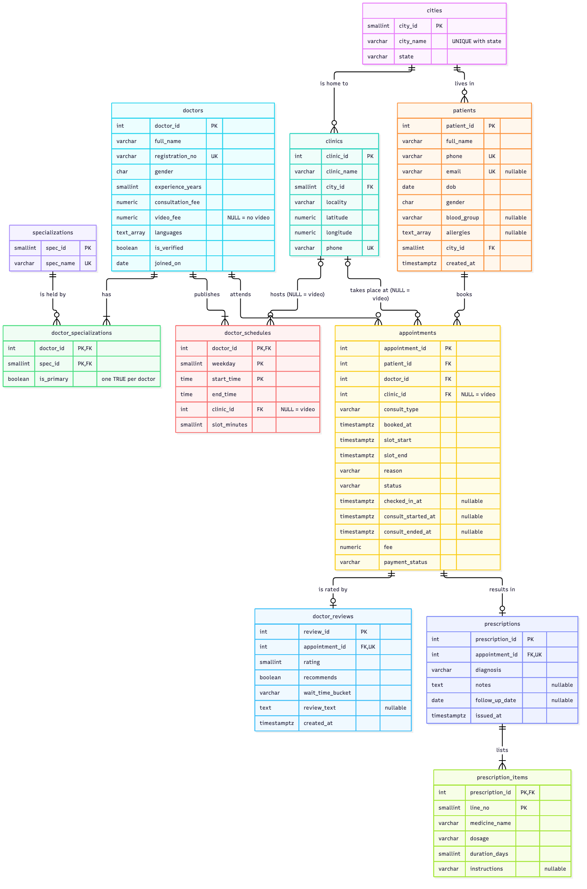
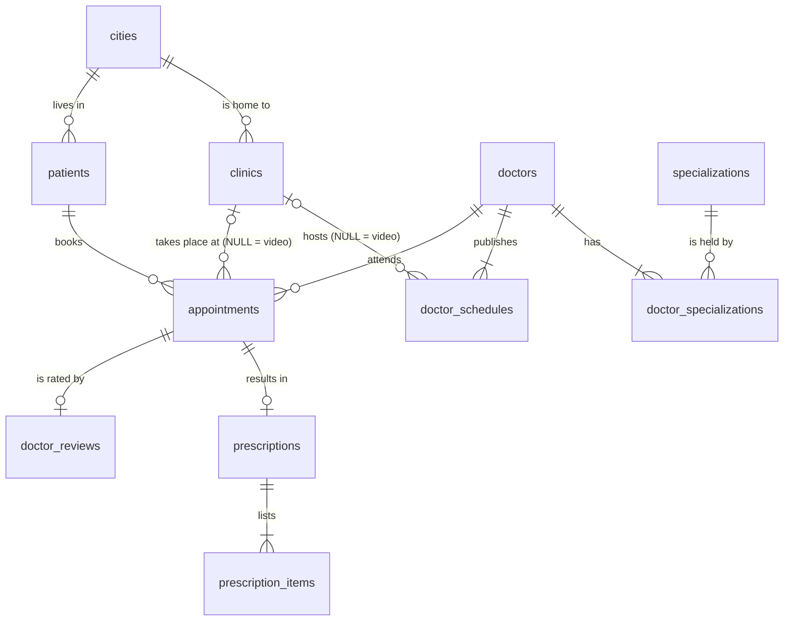

# Phase 2 - Schema design

**Team T0015 (Bluetrace), Section E**

The schema was worked out from the 11 CSV files in `seed_data/`. Every claim below ("never NULL", "always unique", "0 violations") was checked with a query against the loaded data; the results are in sections 7 and 8.

- Schema: [`sql/01_schema.sql`](../sql/01_schema.sql) · Load: [`sql/02_load_data.sql`](../sql/02_load_data.sql)
- ER diagram: [`diagrams/er_diagram.png`](../diagrams/er_diagram.png) · Mermaid source: [`diagrams/er_diagram.mmd`](../diagrams/er_diagram.mmd)
- Totals: 11 tables, 11 primary keys, 12 foreign keys, 8 UNIQUE constraints + 1 partial unique index, 36 CHECK constraints.

## 1. How to run

```bash
createdb practo
unzip seed_data.zip
psql -d practo -v ON_ERROR_STOP=1 -f sql/01_schema.sql
psql -d practo -v ON_ERROR_STOP=1 -f sql/02_load_data.sql   # run from the repo root
```

## 2. Type choices (the rules we applied)

| Kind of value | Type | Why |
|---------------|------|-----|
| Money (`consultation_fee`, `video_fee`, `fee`) | `NUMERIC(8,2)` | Exact decimal. `REAL`/`FLOAT` would give rounding errors in `sum(fee)` (R16). |
| Moments in time (`booked_at`, `slot_start`, ...) | `TIMESTAMPTZ` | The CSV values carry `+05:30`. `TIMESTAMP` would silently drop the offset. |
| Calendar dates (`dob`, `joined_on`, `follow_up_date`) | `DATE` | No time part exists in the data. |
| Time of day (`start_time`, `end_time`) | `TIME` | A weekly schedule repeats, so it has no date. |
| Yes/no (`is_verified`, `is_primary`, `recommends`) | `BOOLEAN` | Data is `t`/`f`. R01 uses `WHERE d.is_verified` directly. |
| Small whole numbers (`weekday`, `slot_minutes`, `rating`, `line_no`, `duration_days`, `experience_years`, `city_id`, `spec_id`) | `SMALLINT` | 2 bytes instead of 4; ranges are tiny. |
| Entity ids (`doctor_id`, `patient_id`, `appointment_id`, ...) | `INTEGER` | 3,000,000 appointments at 20x and 15,000,000 at 100x both fit in 2.1 billion. `BIGINT` would add 4 bytes to every row and every index entry for no benefit. |
| Coordinates | `NUMERIC(9,6)` | Data has exactly 6 decimals (about 11 cm). Exact, and matches the export. |
| Lists (`languages`, `allergies`) | `TEXT[]` | Data is `{English,Hindi}`. R10 uses `allergies @> ARRAY['Penicillin']` and R18 uses `'Tamil' = ANY (languages)`; both need an array, and `ARRAY['Penicillin']` is `text[]`. |
| Short codes (`status`, `consult_type`, `payment_status`, `blood_group`, `dosage`, `gender`) | `VARCHAR(n)` / `CHAR(1)` + `CHECK` | Allowed values are enforced by CHECK. We chose CHECK over `ENUM` because adding a status later is a simple constraint change. |
| Free text (`notes`, `review_text`) | `TEXT` | No natural length limit. |

## 3. Data dictionary

`NN` = NOT NULL. Auto index = PostgreSQL creates it for the PK/UNIQUE.

### cities (10 rows)
| Column | Type | Constraint | Why |
|--------|------|------------|-----|
| city_id | SMALLINT | PK | 10 rows; surrogate key used by `clinics` and `patients`. |
| city_name | VARCHAR(50) | NN, UNIQUE (city_name, state) | Two states can have a city with the same name, so the natural key is the pair. |
| state | VARCHAR(50) | NN | 9 states for 10 cities, so not unique alone. |

### specializations (15 rows)
| Column | Type | Constraint | Why |
|--------|------|------------|-----|
| spec_id | SMALLINT | PK | |
| spec_name | VARCHAR(50) | NN, UNIQUE | Natural key. R01 filters on `spec_name = 'Dermatologist'`. |

### doctors (3,000 rows)
| Column | Type | Constraint | Why |
|--------|------|------------|-----|
| doctor_id | INTEGER | PK | |
| full_name | VARCHAR(100) | NN | Only 100 distinct names in 3,000 rows, so it can never be a key. |
| registration_no | VARCHAR(11) | NN, UNIQUE, CHECK `~ '^[A-Z]{2}MC-[0-9]{6}$'` | Medical council number: natural candidate key (3,000 distinct). Format is state code + `MC-` + 6 digits. R23 looks a doctor up by it. |
| gender | CHAR(1) | NN, CHECK IN ('M','F','X') | Data has M and F; X allowed for consistency with patients. |
| experience_years | SMALLINT | NN, CHECK 0..70 | Data is 1..38. |
| consultation_fee | NUMERIC(8,2) | NN, CHECK > 0 | Every doctor has an in-clinic fee (300 to 1,500). |
| video_fee | NUMERIC(8,2) | NULL, CHECK > 0 when present | **NULL for 894 doctors = the doctor does not offer video.** Verified: a doctor has a `video_fee` exactly when they have a video schedule block (0 exceptions). |
| languages | TEXT[] | NN, CHECK at least 1 element and no NULL element | Every doctor speaks at least English in the data. |
| is_verified | BOOLEAN | NN, DEFAULT FALSE | A new doctor is unverified until checked. |
| joined_on | DATE | NN | |

### doctor_specializations (3,700 rows)
| Column | Type | Constraint | Why |
|--------|------|------------|-----|
| doctor_id | INTEGER | PK part, FK → doctors ON DELETE CASCADE | |
| spec_id | SMALLINT | PK part, FK → specializations ON DELETE RESTRICT | |
| is_primary | BOOLEAN | NN, DEFAULT FALSE | |

- **PK is (doctor_id, spec_id)**: a doctor has 1 or 2 specializations and each specialization has many doctors (M:N). Neither column is unique alone.
- **What stops a doctor having two primary specializations?** The PK does not. We added a **partial unique index** `uq_ds_one_primary_per_doctor ON (doctor_id) WHERE is_primary`. It only contains the primary rows, so two primary rows for one doctor collide. PostgreSQL has no `UNIQUE ... WHERE` constraint syntax, so an index is the only way to declare this rule; it enforces integrity and is not a tuning index. Verified: 3,000 primary rows for 3,000 doctors.
- It does not force *at least* one primary. The data has exactly one for every doctor (check IC9), but enforcing "at least one" needs a trigger or a deferred constraint, which is outside the allowed constraint types.

### clinics (1,500 rows)
| Column | Type | Constraint | Why |
|--------|------|------------|-----|
| clinic_id | INTEGER | PK | |
| clinic_name | VARCHAR(100) | NN | Unique in the seed, but only because the generator appends a number. Two real clinics can share a name, so we did not make it UNIQUE. |
| city_id | SMALLINT | NN, FK → cities ON DELETE RESTRICT | |
| locality | VARCHAR(60) | NN | |
| latitude | NUMERIC(9,6) | NN, CHECK -90..90 | |
| longitude | NUMERIC(9,6) | NN, CHECK -180..180 | |
| phone | VARCHAR(15) | NN, UNIQUE, CHECK `~ '^\+91-[0-9]{2}-[0-9]{7}$'` | Reception landline; candidate key (1,500 distinct). |

### doctor_schedules (30,499 rows)
| Column | Type | Constraint | Why |
|--------|------|------------|-----|
| doctor_id | INTEGER | PK part, FK → doctors ON DELETE CASCADE | |
| weekday | SMALLINT | PK part, CHECK 0..6 | PostgreSQL DOW numbering (0 = Sunday). Data uses 1..6 only. |
| start_time | TIME | PK part | |
| end_time | TIME | NN, CHECK `end_time > start_time` | |
| clinic_id | INTEGER | NULL, FK → clinics ON DELETE RESTRICT | **NULL for 5,899 rows = video consultation block.** |
| slot_minutes | SMALLINT | NN, CHECK IN (10, 15, 20) | Only these three slot lengths exist. |

- **PK is (doctor_id, weekday, start_time)**: there is no id column. A doctor cannot begin two blocks at the same moment wherever they are, so `clinic_id` is not part of the key (and it could not be, because it is NULL for video). Verified: 30,499 distinct triples for 30,499 rows.
- The PK does not stop *overlapping* blocks (10:00-13:00 and 11:00-12:00). The data has none (check IC11). Enforcing it needs an `EXCLUDE` constraint with a range type, which we note as a possible later improvement.

### patients (40,000 rows)
| Column | Type | Constraint | Why |
|--------|------|------------|-----|
| patient_id | INTEGER | PK | |
| full_name | VARCHAR(100) | NN | 500 distinct names; not a key. |
| phone | VARCHAR(10) | NN, UNIQUE, CHECK `~ '^[6-9][0-9]{9}$'` | Sign-in identifier (R06). Text, not a number: it is never added up and must keep its exact digits. |
| email | VARCHAR(254) | NULL, UNIQUE, CHECK email shape | **NULL for 13,940 patients** who signed up by phone only. UNIQUE ignores NULLs, so this works. The 26,060 present values are all distinct. |
| dob | DATE | NN, CHECK ≥ 1900-01-01 | R17 computes age groups from it. |
| gender | CHAR(1) | NN, CHECK IN ('M','F','X') | Data has all three. |
| blood_group | VARCHAR(3) | NULL, CHECK IN the 8 ABO/Rh groups | **NULL for 3,204 patients = not known / never tested.** R17 shows them as `'unknown'`. |
| allergies | TEXT[] | NULL, CHECK not an empty array, no NULL element | **NULL for 33,986 patients = no known allergies.** The CHECK forbids `{}` so "no allergies" has one representation only. |
| city_id | SMALLINT | NN, FK → cities ON DELETE RESTRICT | |
| created_at | TIMESTAMPTZ | NN | |

### appointments (150,000 rows)
| Column | Type | Constraint | Why |
|--------|------|------------|-----|
| appointment_id | INTEGER | PK | |
| patient_id | INTEGER | NN, FK → patients ON DELETE RESTRICT | |
| doctor_id | INTEGER | NN, FK → doctors ON DELETE RESTRICT | |
| clinic_id | INTEGER | NULL, FK → clinics ON DELETE RESTRICT | **NULL for 27,856 rows = exactly the VIDEO appointments.** |
| consult_type | VARCHAR(10) | NN, CHECK IN ('IN_CLINIC','VIDEO') | |
| booked_at | TIMESTAMPTZ | NN | |
| slot_start | TIMESTAMPTZ | NN | |
| slot_end | TIMESTAMPTZ | NN | |
| reason | VARCHAR(200) | NN | Never empty in the data; reception needs it. |
| status | VARCHAR(12) | NN, DEFAULT 'BOOKED', CHECK IN ('BOOKED','CHECKED_IN','COMPLETED','CANCELLED','NO_SHOW') | The seed has only 4 values. `CHECKED_IN` never appears, but W02 writes it, so it must be allowed. |
| checked_in_at | TIMESTAMPTZ | NULL | Filled only for COMPLETED in-clinic visits (98,820 rows). NULL for every video call and every BOOKED / CANCELLED / NO_SHOW row. |
| consult_started_at | TIMESTAMPTZ | NULL | Filled exactly when status = COMPLETED (121,409 rows). |
| consult_ended_at | TIMESTAMPTZ | NULL | Same as above. |
| fee | NUMERIC(8,2) | NN, CHECK ≥ 0 | Price snapshot (section 6). |
| payment_status | VARCHAR(10) | NN, DEFAULT 'PENDING', CHECK IN ('PENDING','PAID','REFUNDED') | |

Rules that tie columns together (all CHECK constraints):

| Constraint | Rule | Why |
|------------|------|-----|
| `ck_appt_slot_order` | `slot_end > slot_start` | |
| `ck_appt_booked_before_slot` | `booked_at <= slot_start` | You cannot book a slot in the past. |
| `ck_appt_clinic_iff_in_clinic` | `(consult_type = 'IN_CLINIC') = (clinic_id IS NOT NULL)` | In-clinic ⇔ has a clinic. |
| `ck_appt_checkin_only_in_clinic` | `checked_in_at IS NULL OR consult_type = 'IN_CLINIC'` | Only clinic visits are checked in. |
| `ck_appt_checked_in_has_time` | `status <> 'CHECKED_IN' OR checked_in_at IS NOT NULL` | Status and timestamp cannot disagree. |
| `ck_appt_consult_order` | an end time needs a start time, and end > start | |
| `ck_appt_completed_iff_ended` | `(status = 'COMPLETED') = (consult_ended_at IS NOT NULL)` | W04 relies on this (`consult_ended_at IS NULL`). |
| `ck_appt_refund_only_cancelled` | `payment_status <> 'REFUNDED' OR status = 'CANCELLED'` | Refunds only for cancellations (W05 sets both together). |

**No UNIQUE (doctor_id, slot_start).** It is the obvious rule, but the data breaks it: 559 pairs of active appointments share a doctor and a slot (data problem 1), and R24 exists to find them.

### prescriptions (97,234 rows)
| Column | Type | Constraint | Why |
|--------|------|------------|-----|
| prescription_id | INTEGER | PK | |
| appointment_id | INTEGER | NN, UNIQUE, FK → appointments ON DELETE RESTRICT | UNIQUE makes it 1:1 (at most one prescription per appointment). 97,234 distinct. |
| diagnosis | VARCHAR(200) | NN | |
| notes | TEXT | NULL | Optional (empty in 58,105 rows). |
| follow_up_date | DATE | NULL, CHECK later than the IST date of `issued_at` | **NULL for 68,184 rows = no follow-up needed.** |
| issued_at | TIMESTAMPTZ | NN | |

### prescription_items (243,085 rows)
| Column | Type | Constraint | Why |
|--------|------|------------|-----|
| prescription_id | INTEGER | PK part, FK → prescriptions ON DELETE CASCADE | |
| line_no | SMALLINT | PK part, CHECK ≥ 1 | 1..4 in the data. |
| medicine_name | VARCHAR(100) | NN | |
| dosage | VARCHAR(5) | NN, CHECK `~ '^[0-9]-[0-9]-[0-9]$'` and `<> '0-0-0'` | Morning-afternoon-night, e.g. `1-0-1`. A dosage of nothing is meaningless. |
| duration_days | SMALLINT | NN, CHECK 1..365 | Data: 3, 5, 7, 10, 30. |
| instructions | VARCHAR(100) | NULL | Optional (empty in 97,233 rows). |

- **PK is (prescription_id, line_no)**: `line_no` restarts at 1 for each prescription, so it only identifies a row together with its prescription. This is a weak entity.

### doctor_reviews (30,339 rows)
| Column | Type | Constraint | Why |
|--------|------|------------|-----|
| review_id | INTEGER | PK | |
| appointment_id | INTEGER | NN, UNIQUE, FK → appointments ON DELETE CASCADE | One review per appointment. The doctor is reached through the appointment, so there is no `doctor_id` here. |
| rating | SMALLINT | NN, CHECK 1..5 | |
| recommends | BOOLEAN | NN | |
| wait_time_bucket | VARCHAR(10) | NN, CHECK IN ('<15 min','15-30 min','30-60 min','>1 hr') | |
| review_text | TEXT | NULL | Optional (empty in 12,069 rows). |
| created_at | TIMESTAMPTZ | NN | |

## 4. Foreign keys and delete rules

| Child → parent | ON DELETE | Why |
|----------------|-----------|-----|
| clinics.city_id → cities | RESTRICT | Lookup row in use must not vanish. |
| patients.city_id → cities | RESTRICT | Same. |
| doctor_specializations.doctor_id → doctors | CASCADE | The link row describes the doctor and means nothing without them. |
| doctor_specializations.spec_id → specializations | RESTRICT | Deleting "Dermatologist" must not silently strip it from 200 doctors. |
| doctor_schedules.doctor_id → doctors | CASCADE | A timetable belongs to its doctor. |
| doctor_schedules.clinic_id → clinics | RESTRICT | **Not SET NULL**: NULL means "video", so SET NULL would turn a clinic block into a video block. |
| appointments.patient_id → patients | RESTRICT | Appointments are medical and financial records. |
| appointments.doctor_id → doctors | RESTRICT | Same. This also means a doctor with history cannot be deleted, so the CASCADE rules above only fire for a doctor who never had an appointment. |
| appointments.clinic_id → clinics | RESTRICT | Same; and SET NULL would break `ck_appt_clinic_iff_in_clinic`. |
| prescriptions.appointment_id → appointments | RESTRICT | A prescription is a legal medical record. |
| prescription_items.prescription_id → prescriptions | CASCADE | Weak entity: lines cannot exist without the prescription. |
| doctor_reviews.appointment_id → appointments | CASCADE | An opinion about an appointment that no longer exists is meaningless. |

## 5. Relationships and ER diagram

| Relationship | Cardinality | How it is implemented |
|--------------|-------------|-----------------------|
| city - clinic | 1:N | `clinics.city_id` |
| city - patient | 1:N | `patients.city_id` |
| doctor - specialization | M:N | junction table `doctor_specializations` |
| doctor - schedule block | 1:N | `doctor_schedules.doctor_id` |
| clinic - schedule block | 1:N, optional on the clinic side | `doctor_schedules.clinic_id` (NULL = video) |
| doctor - clinic | M:N | through `doctor_schedules` (a doctor works at several clinics) |
| patient - appointment | 1:N | `appointments.patient_id` |
| doctor - appointment | 1:N | `appointments.doctor_id` |
| clinic - appointment | 1:N, optional | `appointments.clinic_id` (NULL = video) |
| appointment - prescription | 1:0..1 | `prescriptions.appointment_id` UNIQUE |
| prescription - item | 1:N (at least 1) | `prescription_items.prescription_id` |
| appointment - review | 1:0..1 | `doctor_reviews.appointment_id` UNIQUE |



Mermaid source (also in `diagrams/er_diagram.mmd`, which lists every column):



## 6. Normal forms

Every table has a key, and every non-key column depends on the whole key and on nothing else, so each table is in BCNF, with the exceptions discussed below.

| Table | Candidate keys | Functional dependencies | Normal form |
|-------|----------------|-------------------------|-------------|
| cities | {city_id}, {city_name, state} | city_id → city_name, state | BCNF |
| specializations | {spec_id}, {spec_name} | spec_id → spec_name; spec_name → spec_id | BCNF |
| doctors | {doctor_id}, {registration_no} | doctor_id → all other columns; registration_no → doctor_id | BCNF |
| doctor_specializations | {doctor_id, spec_id} | (doctor_id, spec_id) → is_primary | BCNF. `is_primary` depends on the pair, not on either column alone, so there is no partial dependency. |
| clinics | {clinic_id}, {phone} | clinic_id → all other columns | BCNF. City name and state are in `cities`, not repeated here. |
| doctor_schedules | {doctor_id, weekday, start_time} | key → end_time, clinic_id, slot_minutes | BCNF |
| patients | {patient_id}, {phone} | patient_id → all other columns; phone → patient_id | BCNF |
| appointments | {appointment_id} | appointment_id → all other columns | 3NF as a table; contains derived columns (below) |
| prescriptions | {prescription_id}, {appointment_id} | prescription_id → appointment_id, diagnosis, notes, follow_up_date, issued_at | BCNF |
| prescription_items | {prescription_id, line_no} | key → medicine_name, dosage, duration_days, instructions | BCNF |
| doctor_reviews | {review_id}, {appointment_id} | review_id → all other columns | BCNF as a table; `wait_time_bucket` is derived (below) |

Points we checked instead of assuming:

- **Arrays and 1NF.** `languages` and `allergies` hold several values in one column, which strictly breaks 1NF. The fully normalized design would be `doctor_languages(doctor_id, language)` and `patient_allergies(patient_id, allergy)`. We kept arrays because the CSV headers and the given queries (R10 `@>`, R18 `= ANY`) require them, the lists are short, and PostgreSQL can index arrays with GIN.
- **A dependency that looks real but is not.** In `doctor_schedules`, `start_time → end_time` holds in the seed (only 10:00-13:00, 17:00-20:00 and 21:00-22:00 exist). That is how the generator works, not a business rule, so we did not split the table on it.
- **medicine_name** in `prescription_items` has only 15 distinct values and could be a `medicines` lookup table. That would be a design improvement, not a normal-form violation: no other column depends on the medicine name. We kept the column because the queries read `i.medicine_name` directly.

### Derived and redundant columns

| Column | Derivable from | Checked on the data | Keep? |
|--------|----------------|---------------------|-------|
| `appointments.fee` | `doctors.consultation_fee` or `doctors.video_fee`, by `consult_type` | 0 mismatches in 150,000 rows | **Keep.** It is a price snapshot. If a doctor raises the fee next month, last month's appointments must still show what was actually charged, and `sum(fee)` in R16 must not change. |
| `appointments.slot_end` | `slot_start` + the schedule's `slot_minutes` | 0 mismatches | **Keep.** The schedule can change later, and finding the right schedule row needs a join on weekday and time range. W04 filters directly on `slot_end`. |
| `appointments.consult_type` | `clinic_id IS NULL` | exact match | **Keep, but guarded.** Redundant, but queries filter on it; `ck_appt_clinic_iff_in_clinic` makes disagreement impossible. |
| `appointments.clinic_id` | the schedule row for that doctor, weekday and time | 0 mismatches | **Keep.** Same reason as `slot_end`; R09 and R16 group by it. |
| `doctor_reviews.wait_time_bucket` | `appointments.consult_started_at - slot_start` | 0 mismatches in 30,339 rows | **Redundant.** It is a transitive dependency through `appointment_id` into another table. In a new design we would drop it and compute it in a view. We keep it only because the schema must match the CSV headers; the risk is that it disagrees with the timestamps if an appointment is corrected later. |

## 7. Load result

```
       table_name       |  rows  | expected
------------------------+--------+----------
 cities                 |     10 |       10
 specializations        |     15 |       15
 doctors                |   3000 |     3000
 doctor_specializations |   3700 |     3700
 clinics                |   1500 |     1500
 doctor_schedules       |  30499 |    30499
 patients               |  40000 |    40000
 appointments           | 150000 |   150000
 prescriptions          |  97234 |    97234
 prescription_items     | 243085 |   243085
 doctor_reviews         |  30339 |    30339
```

All 11 files load with every constraint enabled, with no rows rejected. `queries/workload_30.sql` then runs from start to finish with no errors. Database size after load: 82 MB.

Indexes that exist after Phase 2 (all created automatically by PRIMARY KEY / UNIQUE, plus the one partial unique index). **No tuning index exists.**

| Table | Indexes |
|-------|---------|
| cities | `cities_pkey`, `uq_cities_name_state` |
| specializations | `specializations_pkey`, `uq_specializations_name` |
| doctors | `doctors_pkey`, `uq_doctors_registration_no` |
| doctor_specializations | `pk_doctor_specializations`, `uq_ds_one_primary_per_doctor` (partial) |
| clinics | `clinics_pkey`, `uq_clinics_phone` |
| doctor_schedules | `pk_doctor_schedules` |
| patients | `patients_pkey`, `uq_patients_phone`, `uq_patients_email` |
| appointments | `appointments_pkey` |
| prescriptions | `prescriptions_pkey`, `uq_prescriptions_appointment` |
| prescription_items | `pk_prescription_items` |
| doctor_reviews | `doctor_reviews_pkey`, `uq_reviews_appointment` |

Note that `appointments` has an index on `appointment_id` only. Its three foreign key columns are not indexed, because PostgreSQL does not index the referencing side of a foreign key.

## 8. Integrity checks

Run after the load. "Violations" is the number of rows that break the rule.

| # | Rule checked | Violations | Verdict |
|---|--------------|-----------:|---------|
| IC1 | Every appointment falls inside a schedule block of that doctor on that weekday, at the same place, with the same slot length | 0 | Holds |
| IC2 | An in-clinic appointment is at a clinic where the doctor has a schedule | 0 | Holds |
| IC3 | No patient allergic to penicillin is prescribed amoxicillin | **726 lines, 545 patients** | Data problem 2 |
| IC4 | `appointments.fee` equals the doctor's fee for that consult type | 0 | Holds |
| IC5 | `wait_time_bucket` agrees with the actual wait | 0 | Holds |
| IC6 | Prescriptions and reviews exist only for COMPLETED appointments; every prescription has at least one item | 0 / 0 / 0 | Holds |
| IC7 | No two active appointments share a doctor and a slot | **559 pairs** | Data problem 1 |
| IC8 | Check-in happens before the consultation starts, and after booking | **16,183** and **5** | Data problem 3 |
| IC9 | A doctor has a `video_fee` exactly when they have a video schedule; every doctor has a primary specialization | 0 / 0 | Holds |
| IC10 | Clinics with no schedule: correct count vs what R13 returns | **292 vs 0** | Data problem 5 |
| IC11 | No overlapping schedule blocks; no appointment booked before the patient signed up | 0 / **1,072** | Data problem 4 |

Queries and raw output for the main three:

```sql
-- IC1: appointments outside the doctor's weekly schedule
SELECT count(*) AS outside_schedule FROM appointments a
WHERE NOT EXISTS (SELECT 1 FROM doctor_schedules s
  WHERE s.doctor_id = a.doctor_id
    AND s.weekday = EXTRACT(DOW FROM a.slot_start AT TIME ZONE 'Asia/Kolkata')
    AND (a.slot_start AT TIME ZONE 'Asia/Kolkata')::time >= s.start_time
    AND (a.slot_end   AT TIME ZONE 'Asia/Kolkata')::time <= s.end_time
    AND s.clinic_id IS NOT DISTINCT FROM a.clinic_id
    AND a.slot_end - a.slot_start = s.slot_minutes * interval '1 minute');
 outside_schedule
------------------
                0

-- IC2: in-clinic appointments at a clinic where the doctor has no schedule
SELECT count(*) AS wrong_clinic FROM appointments a
WHERE a.clinic_id IS NOT NULL
  AND NOT EXISTS (SELECT 1 FROM doctor_schedules s
                  WHERE s.doctor_id = a.doctor_id AND s.clinic_id = a.clinic_id);
 wrong_clinic
--------------
            0

-- IC3: penicillin-allergic patients prescribed amoxicillin
SELECT count(*) AS conflict_lines, count(DISTINCT pt.patient_id) AS patients
FROM patients pt
JOIN appointments a       ON a.patient_id = pt.patient_id
JOIN prescriptions p      ON p.appointment_id = a.appointment_id
JOIN prescription_items i ON i.prescription_id = p.prescription_id
WHERE pt.allergies @> ARRAY['Penicillin'] AND i.medicine_name ILIKE '%amoxicillin%';
 conflict_lines | patients
----------------+----------
            726 |      545
```

Other raw results:

```
 fee_mismatch = 0                                   -- IC4
 bucket_mismatch = 0                                -- IC5
 presc_not_completed = 0 | review_not_completed = 0 | presc_without_items = 0     -- IC6
 double_booked_pairs = 559                          -- IC7
 checkin_after_consult_start = 16183 | checkin_before_booking = 5 | started_before_slot = 0   -- IC8
 video_fee_vs_video_schedule = 0 | doctors_without_primary_spec = 0               -- IC9
 not_exists_answer = 292 | r13_not_in_answer = 0    -- IC10
 overlapping_blocks = 0 | booked_before_signup = 1072 | booked_before_doctor_joined = 0       -- IC11
```

## 9. Data problems found

No row was rejected by the load. The problems below are in the data itself; in each case we chose not to add the constraint that the data breaks, and we say so.

1. **Double bookings (559 pairs).** Two non-cancelled appointments for the same doctor at the same `slot_start`. This is why there is no `UNIQUE (doctor_id, slot_start)`. The correct fix is a partial unique index `(doctor_id, slot_start) WHERE status <> 'CANCELLED'`, which can only be added after the duplicates are resolved. Booking (W01) does not check for a clash either. Also, 23 patients hold two active appointments at the same time.
2. **Allergy conflicts (726 prescription lines, 545 patients).** Patients recorded as allergic to penicillin were prescribed amoxicillin. A CHECK cannot see another table, so this cannot be a column constraint; it needs a trigger or an application check at prescription time. R10 is the report that finds them.
3. **Check-in times that cannot be right.** In 16,183 completed clinic visits `checked_in_at` is later than `consult_started_at`, and in 5 it is earlier than `booked_at`. So we could not add `checked_in_at <= consult_started_at`. Reception is probably entering check-in after the fact.
4. **Appointments booked before the patient account existed (1,072 rows).** `booked_at < patients.created_at`. Likely accounts that were re-created or migrated. No constraint is possible across tables.
5. **R13 returns a wrong answer.** `clinic_id NOT IN (SELECT clinic_id FROM doctor_schedules)` returns 0 rows, but 292 clinics really have no schedule. The subquery contains NULLs (the 5,899 video blocks), and `x NOT IN (..., NULL)` is never TRUE: it is either FALSE or UNKNOWN. This is the cause of P5 ("the list is always empty"). The fix, `NOT EXISTS`, belongs to Phase 4.
6. **`CHECKED_IN` never appears in the seed** although W02 sets it. Reading allowed values from the data alone would have produced a CHECK that makes W02 fail.
7. **Names are synthetic.** 100 distinct doctor names and 500 distinct patient names, and gender does not follow the name. Names must never be used as keys or to match people.
8. **No Sunday schedules.** `weekday` is 1..6 only, so the data cannot tell us whether Sunday would be 0 or 7. We allow 0..6, which matches PostgreSQL's `EXTRACT(DOW ...)`.

## 10. Environment note

Tested on PostgreSQL 16.15 (Homebrew, macOS, Apple Silicon): schema, load and the 30-query workload all run without errors. Session time zone is `Asia/Kolkata`; queries that use `DATE(slot_start)` depend on it.
